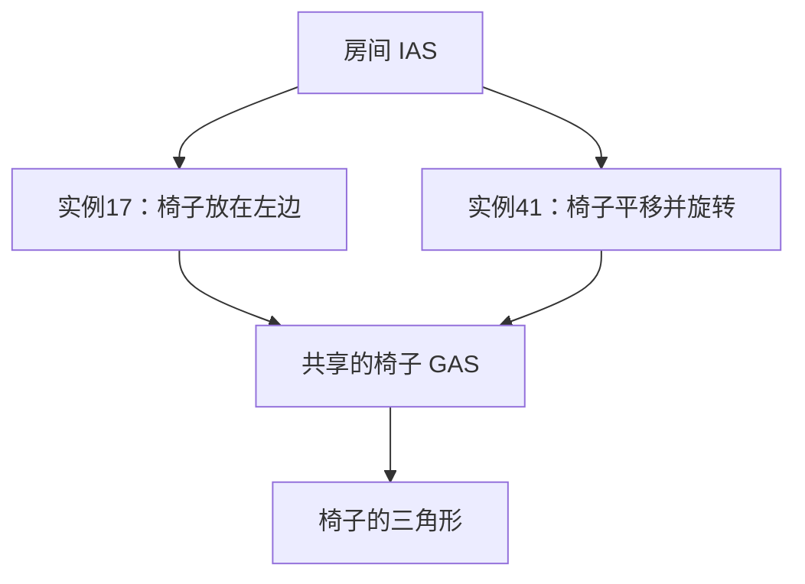

# 从 ray 到裸 TTU：当前协议入门

更新：2026-11-03。阅读不需要熟悉 OptiX。前半部分解释公开的光线追踪概念，后半部分解释本项目在 RTX 3090 / SM86、driver 535.309.01 上实际验证的请求和返回。它不是 NVIDIA 官方硬件规范，也不是 SM120 的实测结论。

本文解释概念，编码/偏移和具体反例统一查 [协议](TTU_PROTOCOL.md)，周期数查 [测量](MEASUREMENTS.md)，Bunny与单次镜面查 [renderer](RENDERER.md)。复杂IAS逆向继续挂起。

## 1. 一条 ray 究竟要问什么

你熟悉的四个输入组成一条带有效区间的射线：

```text
P(t) = origin + t × direction
tmin ≤ t ≤ tmax
```

常见问题是：“这段 ray 最先碰到哪个表面？碰到哪里？”这叫最近命中（closest hit）。也可以只问“途中有没有挡住它的东西”，例如阴影查询；这种查询未必需要找最近表面。

`t` 是沿 direction 的参数。direction 长度为1时，t才等于从origin出发的距离；如果 direction 变成原来的2倍，同一交点的t会减半。我们已经测试非单位方向，CPU oracle也按参数t比较。

场景可以由很多三角形组成。一个三角形就是这里的一项 primitive（几何基本单元）。最笨的做法是逐个求交；BVH的作用是跳过大批不可能命中的三角形。

## 2. BVH、AS、GAS、IAS分别是什么

BVH可以看成一棵装盒子的树：大盒子包住若干小盒子，下面再放更小的盒子，最后关联三角形等几何。ray没有碰到一个大盒子，就不必检查里面任何东西。**碰到盒子只表示里面可能有交点，不等于已经碰到了真实表面。**

AS（Acceleration Structure，加速结构）是供追踪使用的数据结构总称。这里可以近似理解为“按硬件格式存好的BVH，加上相关几何和元数据”。OptiX接收顶点等输入后构建AS；AS二进制布局不是顶点数组的简单改名。

| 名字 | 管理什么 | 例子 |
|---|---|---|
| GAS：Geometry Acceleration Structure | 一份几何在自身坐标系里的加速结构 | 一把椅子的所有三角形 |
| instance：实例 | 对一份子AS的一次摆放/引用，附带变换和属性 | “把这把椅子放在桌子左边，旋转90度” |
| IAS：Instance Acceleration Structure | 多个实例的加速结构 | 快速判断ray可能碰到房间里的哪几把椅子 |

GAS大致对应其他API常说的BLAS，IAS大致对应TLAS；这里只讲常见的静态两层场景，OptiX还允许其他受约束的层次组合。只有一个模型时可以直接追踪GAS，不必为了使用RT Core而额外建立IAS。

**instance不是每个BVH节点或每个AABB上都附加一个transform。** 它是对某份子结构的一次场景引用。十把形状相同的椅子可以共用一份GAS，每把椅子的instance保存自己的位置、朝向、缩放，以及instance ID、可见性mask等属性。它们的三角形不必复制十份。



从概念上说，先在世界坐标里查IAS；遇到可能命中的instance，再把ray转到那把椅子的局部坐标里查GAS。instance通常提供从局部到世界的3×4仿射变换，转ray时用其逆变换。origin作为点变换，direction作为向量变换，不包含平移。

一个有用的细节：如果变换后的direction不重新归一化，那么同一个交点的t可以保持不变，包括非均匀缩放的情况。因为逆变换满足 `M⁻¹(O + tD) = M⁻¹(O) + t × M⁻¹_linear(D)`。Phase16/17已在普通CUDA指令中实现并验证这段变换，非均匀缩放时也不重新归一化direction。

primitive ID回答“这份几何里的第几个三角形”，instance ID回答“场景里的哪次摆放”。十把椅子上的同一个三角形可以有相同primitive ID、不同instance ID。

## 3. barycentric：交点在三角形里的位置

barycentric通常译作“重心坐标”。这里的“重心”不是只指三角形中心，而是一种表示三角形内部任意位置的方法。

给三个顶点命名为A、B、C，返回的两个数u、v表示：

```text
P = (1-u-v) × A + u × B + v × C
```

也就是给三个顶点分配权重 `(1-u-v, u, v)`，总和为1。内部点满足 `u≥0、v≥0、u+v≤1`。例如 `u=0.125、v=0.625`，三个权重就是 `(0.25, 0.125, 0.625)`。

同一个交点有两种描述：`origin+t×direction` 说明它在ray上的位置，重心坐标说明它在三角形上的位置。知道三个顶点就能互相核对；顶点上若还保存颜色、纹理坐标或法线，也可以用这三个权重插值。它不是ray方向，也不是BVH指针。

三角形的front/back face由顶点绕序和ray从哪一侧射入共同决定。默认并不因为是背面就必然忽略；是否剔除要看flags。

## 4. ray flags在控制什么

flags是给这次查询的规则：某些面要不要忽略、几何交点需不需要交给程序进一步判断等。先区分“数学上碰到了三角形”和“应用接受这个交点”。

例如一张树叶贴图实际铺在一个矩形上：ray碰到矩形里的透明像素时，应用可能拒绝该交点，让ray继续找后面的表面。OptiX的any-hit程序可以作这种判断。名字里的any-hit不等于“硬件最终随便返回一个交点”；这是处理候选交点的程序阶段。遍历结束后，closest-hit程序处理最终接受的最近交点；没有接受的交点则走miss。

这里的“软件”通常也是在GPU的SM上执行的普通指令，不是回到CPU执行回调。对本项目的三角形场景，RT硬件做包围盒/三角形求交；any-hit程序可以读取纹理或其他应用数据，再选择忽略交点、接受交点并继续，或接受交点并终止追踪。接受一个候选不等于它就是最近交点：遍历发现候选的顺序不保证按t从小到大，继续遍历可能找到更近的。禁用any-hit也不等于只找第一个交点；“首次命中即终止”是另一条规则。

应用编写的any-hit程序与驱动生成的协议控制代码也要区分。当前 `kernels/scene_oracle.cu` 没有any-hit入口，只有raygen/closest-hit/miss；OptiX仍能完成flags0的最近命中，而裸提交存在较远候选反例。这说明即使没有用户any-hit程序，也不能省略尚未理解的协议事件处理。该反例本身没有验证真实alpha测试或accept/ignore的编码。

本项目目前只实现/验证以下ray flags：

| OptiX枚举值 | 含义 | 当前裸TTU边界 |
|---|---|---|
| `NONE = 0` | 不加这些覆盖规则；不是“所有东西自动opaque” | 非opaque多命中可返回候选，不能视为最终最近命中 |
| `DISABLE_ANYHIT = 0x1` | 禁用any-hit程序过滤 | 当前默认；已测三角形场景与最近命中oracle匹配 |
| `CULL_BACK_FACING_TRIANGLES = 0x10` | 忽略背面三角形交点 | 已验证，含反转顶点绕序 |
| `CULL_FRONT_FACING_TRIANGLES = 0x20` | 忽略正面三角形交点 | 已验证，含反转顶点绕序 |

可以按位组合，例如 `0x11` 为禁用any-hit并剔除背面，`0x21` 为禁用any-hit并剔除正面。正面/背面剔除不能同时开。OptiX还有强制any-hit、首次接受命中即终止、跳过closest-hit程序等规则；当前裸TTU入口不接受未验证的位。

还有另一套 **geometry flags**：`OPTIX_GEOMETRY_FLAG_DISABLE_ANYHIT = 1` 是构建几何时的属性；上面的ray flag是每次发射ray时的属性。数值同为1，但属于不同命名空间，作用范围不同。instance也有自己的属性；不能把这些位混在一起直接写入同一个硬件槽。

这里说opaque，主要是指遍历中不用any-hit程序再拒绝交点，不代表已经算好了材质颜色，也不自动规定最终渲染时是否折射或透光。

公开OptiX flag与私有请求编码也不是同一件事。对本机捕获的JIT路径，已对照出：正/背面剔除进入配置寄存器R52的bits4/5；ray的DISABLE_ANYHIT进入R53的bit5，另有R40/R41派生配置。`sm86_fixture.operands()`负责这些映射。其余配置常量没有全部逐位解码；可见性mask等也不能据此声称已通解。

## 5. SM与TTU怎样分工

普通SM代码准备ray和AS引用，通过OPEN/MACROFUSE/ST/GO/LD.CLOSE请求TTU完成遍历/求交，再等待结果依赖。CLOSE不代表结果已经完成，同一个warp可以先做不依赖结果的计算。等待藏在SASS指令控制字段里：LD标记返回依赖槽，消费者等待同一个槽；不需要显式建立共享内存mbarrier对象，但调度间隔也必须正确。融合组不必覆盖整个请求；已测合法拆组间隔内，其他warp仍可发起并完成请求。融合组内逐指令交错、抢占屏蔽尚未实测，细节见 [测量](MEASUREMENTS.md)。

opaque单GAS的triangle最近命中可以一次GO返回；nonopaque候选或IAS instance事件可能需要SM处理后续工作。instance事件提供记录引用，SM读取逆变换，把世界ray变到child局部坐标，再查询child GAS。direction不重新归一化，使参数t在仿射变换下保持一致。

只处理第一个instance不够：它可能miss，后面另一个命中；也可能先遇远处，再遇近处。当前受限实现保存TTU返回的pending引用，查询child后恢复父级，覆盖平坦1–3静态instance、共享GAS。复杂IAS、any-hit accept/ignore、嵌套和一般溢出仍未通解，逆向暂挂。

## 6. 返回的t/u/v是什么

triangle命中返回primitive身份、参数t、重心坐标u/v和正反面信息；miss、instance事件、候选状态必须分类，不能将任意返回的四个word都解成浮点交点。当前观察到的tag和寄存器偏移只在本机已测路径成立。

一次GO访问了多少BVH节点仍不知道。已渲染69,453面GAS只说明输入AS的规模，不表示每条ray检查全部面，也不能推导节点数、树深或硬件容量。更大的GAS仍可由同一请求接口遍历，不必每过一个节点由SM发一次GO。

完整OptiX还包括shader调用、any-hit、custom intersection、motion、嵌套ray和续栈等软件语义，不是一条TTU能概括。小renderer中，SM决定反射方向与颜色，TTU再次求交，正好展示这条边界。

具体寄存器、编码和反例见 [协议](TTU_PROTOCOL.md)，周期数和即时消费者检查见 [测量](MEASUREMENTS.md)，完整运行命令与数值限制见 [renderer](RENDERER.md)。
