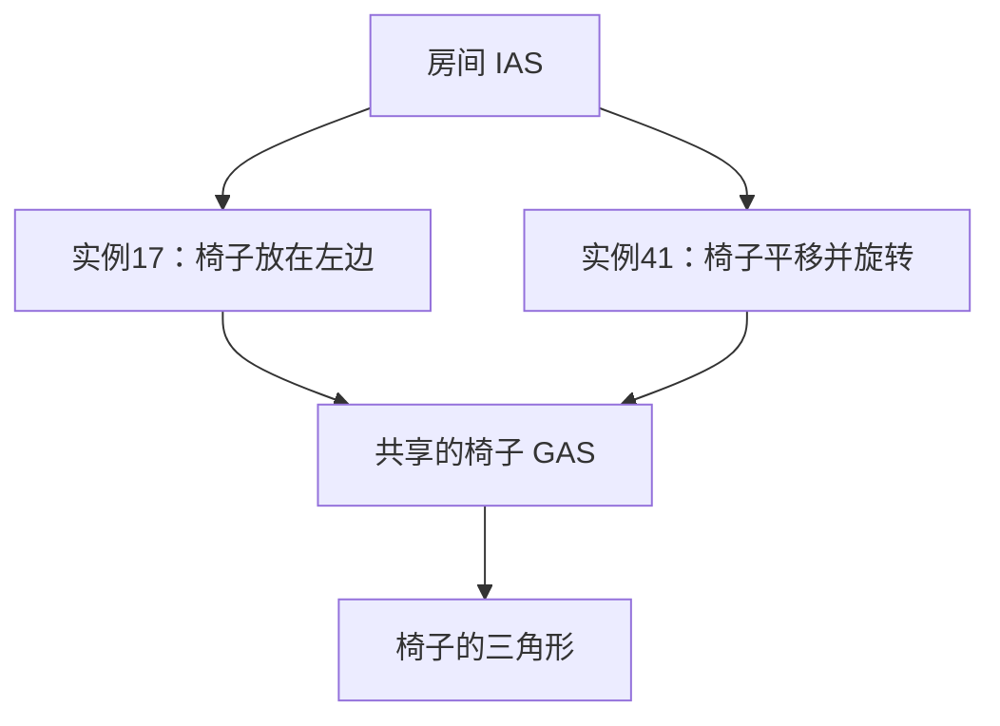

# 从 ray 到裸 TTU：当前协议入门

更新：2026-11-03。阅读不需要熟悉 OptiX。前半部分解释公开的光线追踪概念，后半部分解释本项目在 RTX 3090 / SM86、driver 535.309.01 上实际验证的请求和返回。它不是 NVIDIA 官方硬件规范，也不是 SM120 的实测结论。

最新增量见 [Phase17](PHASE17.md)：一个CUDA kernel可保存硬件返回引用，查child后恢复父IAS；已测平坦1–3个静态instance、共享triangle GAS、正行列式变换及0x21引用类型。还不是通用IAS支持。instance ID/handle的旧相邻偏移已纠正为索引查表；历史host实现见 [Phase15](PHASE15.md)。三角形GAS最大已测4096。

## 1. 一条 ray 究竟要问什么

你熟悉的四个输入组成一条带有效区间的射线：

```text
P(t) = origin + t × direction
tmin ≤ t ≤ tmax
```

常见问题是：“这段 ray 最先碰到哪个表面？碰到哪里？”这叫最近命中（closest hit）。也可以只问“途中有没有挡住它的东西”，例如阴影查询；这种查询未必需要找最近表面。

`t` 是沿 direction 的参数。direction 长度为1时，t才等于从origin出发的距离；如果 direction 变成原来的2倍，同一交点的t会减半。我们已经测试非单位方向，CPU oracle也按参数t比较。

场景可以由很多三角形组成。一个三角形就是这里的一项 primitive（几何基本单元）。最笨的做法是逐个求交；BVH的作用是跳过大批不可能命中的三角形。

## 2. BVH、AS、GAS、IAS分别是什么

BVH可以看成一棵装盒子的树：大盒子包住若干小盒子，下面再放更小的盒子，最后关联三角形等几何。ray没有碰到一个大盒子，就不必检查里面任何东西。**碰到盒子只表示里面可能有交点，不等于已经碰到了真实表面。**

AS（Acceleration Structure，加速结构）是供追踪使用的数据结构总称。这里可以近似理解为“按硬件格式存好的BVH，加上相关几何和元数据”。OptiX接收顶点等输入后构建AS；AS二进制布局不是顶点数组的简单改名。

| 名字 | 管理什么 | 例子 |
|---|---|---|
| GAS：Geometry Acceleration Structure | 一份几何在自身坐标系里的加速结构 | 一把椅子的所有三角形 |
| instance：实例 | 对一份子AS的一次摆放/引用，附带变换和属性 | “把这把椅子放在桌子左边，旋转90度” |
| IAS：Instance Acceleration Structure | 多个实例的加速结构 | 快速判断ray可能碰到房间里的哪几把椅子 |

GAS大致对应其他API常说的BLAS，IAS大致对应TLAS；这里只讲常见的静态两层场景，OptiX还允许其他受约束的层次组合。只有一个模型时可以直接追踪GAS，不必为了使用RT Core而额外建立IAS。

**instance不是每个BVH节点或每个AABB上都附加一个transform。** 它是对某份子结构的一次场景引用。十把形状相同的椅子可以共用一份GAS，每把椅子的instance保存自己的位置、朝向、缩放，以及instance ID、可见性mask等属性。它们的三角形不必复制十份。



从概念上说，先在世界坐标里查IAS；遇到可能命中的instance，再把ray转到那把椅子的局部坐标里查GAS。instance通常提供从局部到世界的3×4仿射变换，转ray时用其逆变换。origin作为点变换，direction作为向量变换，不包含平移。

一个有用的细节：如果变换后的direction不重新归一化，那么同一个交点的t可以保持不变，包括非均匀缩放的情况。因为逆变换满足 `M⁻¹(O + tD) = M⁻¹(O) + t × M⁻¹_linear(D)`。Phase16/17已在普通CUDA指令中实现并验证这段变换，非均匀缩放时也不重新归一化direction。

primitive ID回答“这份几何里的第几个三角形”，instance ID回答“场景里的哪次摆放”。十把椅子上的同一个三角形可以有相同primitive ID、不同instance ID。

## 3. barycentric：交点在三角形里的位置

barycentric通常译作“重心坐标”。这里的“重心”不是只指三角形中心，而是一种表示三角形内部任意位置的方法。

给三个顶点命名为A、B、C，返回的两个数u、v表示：

```text
P = (1-u-v) × A + u × B + v × C
```

也就是给三个顶点分配权重 `(1-u-v, u, v)`，总和为1。内部点满足 `u≥0、v≥0、u+v≤1`。例如 `u=0.125、v=0.625`，三个权重就是 `(0.25, 0.125, 0.625)`。

同一个交点有两种描述：`origin+t×direction` 说明它在ray上的位置，重心坐标说明它在三角形上的位置。知道三个顶点就能互相核对；顶点上若还保存颜色、纹理坐标或法线，也可以用这三个权重插值。它不是ray方向，也不是BVH指针。

三角形的front/back face由顶点绕序和ray从哪一侧射入共同决定。默认并不因为是背面就必然忽略；是否剔除要看flags。

## 4. ray flags在控制什么

flags是给这次查询的规则：某些面要不要忽略、几何交点需不需要交给程序进一步判断等。先区分“数学上碰到了三角形”和“应用接受这个交点”。

例如一张树叶贴图实际铺在一个矩形上：ray碰到矩形里的透明像素时，应用可能拒绝该交点，让ray继续找后面的表面。OptiX的any-hit程序可以作这种判断。名字里的any-hit不等于“硬件最终随便返回一个交点”；这是处理候选交点的程序阶段。遍历结束后，closest-hit程序处理最终接受的最近交点；没有接受的交点则走miss。

这里的“软件”通常也是在GPU的SM上执行的普通指令，不是回到CPU执行回调。对本项目的三角形场景，RT硬件做包围盒/三角形求交；any-hit程序可以读取纹理或其他应用数据，再选择忽略交点、接受交点并继续，或接受交点并终止追踪。接受一个候选不等于它就是最近交点：遍历发现候选的顺序不保证按t从小到大，继续遍历可能找到更近的。禁用any-hit也不等于只找第一个交点；“首次命中即终止”是另一条规则。

应用编写的any-hit程序与驱动生成的协议控制代码也要区分。当前 `scene_oracle.cu` 没有any-hit入口，只有raygen/closest-hit/miss；OptiX仍能完成flags0的最近命中，而裸提交存在较远候选反例。这说明即使没有用户any-hit程序，也不能省略尚未理解的协议事件处理。该反例本身没有验证真实alpha测试或accept/ignore的编码。

本项目目前只实现/验证以下ray flags：

| OptiX枚举值 | 含义 | 当前裸TTU边界 |
|---|---|---|
| `NONE = 0` | 不加这些覆盖规则；不是“所有东西自动opaque” | 非opaque多命中可返回候选，不能视为最终最近命中 |
| `DISABLE_ANYHIT = 0x1` | 禁用any-hit程序过滤 | 当前默认；已测三角形场景与最近命中oracle匹配 |
| `CULL_BACK_FACING_TRIANGLES = 0x10` | 忽略背面三角形交点 | 已验证，含反转顶点绕序 |
| `CULL_FRONT_FACING_TRIANGLES = 0x20` | 忽略正面三角形交点 | 已验证，含反转顶点绕序 |

可以按位组合，例如 `0x11` 为禁用any-hit并剔除背面，`0x21` 为禁用any-hit并剔除正面。正面/背面剔除不能同时开。OptiX还有强制any-hit、首次接受命中即终止、跳过closest-hit程序等规则；当前裸TTU入口不接受未验证的位。

还有另一套 **geometry flags**：`OPTIX_GEOMETRY_FLAG_DISABLE_ANYHIT = 1` 是构建几何时的属性；上面的ray flag是每次发射ray时的属性。数值同为1，但属于不同命名空间，作用范围不同。instance也有自己的属性；不能把这些位混在一起直接写入同一个硬件槽。

这里说opaque，主要是指遍历中不用any-hit程序再拒绝交点，不代表已经算好了材质颜色，也不自动规定最终渲染时是否折射或透光。

公开OptiX flag与私有请求编码也不是同一件事。对本机捕获的JIT路径，已对照出：正/背面剔除进入配置寄存器R52的bits4/5；ray的DISABLE_ANYHIT进入R53的bit5，另有R40/R41派生配置。`sm86_fixture.operands()`负责这些映射。其余配置常量没有全部逐位解码；可见性mask等也不能据此声称已通解。

## 5. SM和TTU目前怎么对话

可以把TTU看作SM通过专用指令提交工作的硬件单元。普通CUDA指令准备输入、处理控制流和结果；TTU负责所提交工作中的硬件遍历/求交。一次提交可能处理很多BVH节点，绝不是一条指令只测试一个盒子。

当前流程可概括为：

```text
普通指令准备 ray、规则、AS入口和初始状态
  → TTUOPEN + TTUMACROFUSE
  → 若干 TTUST 把寄存器内容送到请求槽
  → TTUGO 发起遍历工作
  → TTULD 读回结果/状态，最后一次带 CLOSE
  → 等待结果就绪
  → 普通指令判断：完成了？还是需要处理事件并继续？
```

| 指令/步骤 | 当前可以怎样理解 | 需要保留的限制 |
|---|---|---|
| `TTUOPEN` | 打开一次硬件交互会话 | 不等于已经完成一整次OptiX追踪 |
| `TTUMACROFUSE(count)` | 标记接下来这组TTU指令的范围 | count按指令条数设置；不能直接当作内部微操作数 |
| `TTUST` | 把两对寄存器的内容交给编号请求槽 | 不是往全局内存写BVH节点 |
| `TTUGO` | 发起提交状态对应的遍历工作 | 完成这段工作后可能返回中间事件 |
| `TTULD` | 从返回槽取回内容，写入两对寄存器 | 必须配合正确的结果等待，再由普通指令读取 |
| `TTULD.CLOSE` | 在读回时关闭本次交互会话 | 不是“整条ray保证追踪完”的标志 |

TTUST/TTULD使用两个显式指定的寄存器对，每对内部相邻。比如一次LD把4个32-bit值写到 `R72:R73、R32:R33`。协议中的槽号 `0x300` 是请求/返回接口的编号；AS内偏移 `+0x300` 是另一回事，不能因为数字相同就混为一个地址。

当前13条组为 `OPEN → MF(11) → 9×ST → GO → LD.CLOSE[0x300]`。19条组多读6个返回槽；在已经通过的三角形矩阵中，两组主要结果在10,104对比较里逐位一致。这支持精简读回用于该子集，不说明其他返回槽没用，也没有证明13条是理论最短；Phase18只在所测小fixture上观察到13条的完整计时窗口较短。原20条组在保存的固定fixture上可用，在实时GAS上不稳定，根因仍未确定。详细差别见 [Phase14](PHASE14.md)。

一次GO的内部访问节点数目前没有测出，也没有已验证的容量上限。实证是：在原1024三角形矩阵及后补4096三角形GAS测试中，一条ray通过一次GO即可得到与CPU/OptiX一致的最近命中（已测opaque子集），并分别验证了不同位置的primitive。1024/4096是主动生成的AS三角形数量，不是每条ray检查的三角形数，更不是BVH节点数；我们尚未解码树拓扑或取得节点访问计数。当前也没有逐次节点访问轨迹，因此不报告“一次GO已证明访问至少N个节点”的具体N。

除了ray，还必须提供有效的AS入口。当前代码把AS地址、经验root偏移和类型/config位打包成描述符；不能直接把OptiX handle当任意裸指针塞进去。已测GAS样本root偏移为 `0x300`，IAS样本为 `0x380`，从AS头部 `+0x20` 的经验字段取得；这不是所有AS都适用的公开布局保证。

还要提供一个从JIT静态数据提取的dummy root对象，其中含单位变换。这是当前提交路径的初始状态要求；它与“场景里有一个真实instance”不是同一概念。我们已能自行分配、复制和编码这个对象，无需运行原驱动megakernel，但尚未完全解释其所有字段。

`TTUCCTL`属于另外的控制/缓存相关探索，当前成功的最小几何路径不依赖它；准确语义仍待确认。80 registers/thread、无显式local/shared/stack只是当前kernel资源声明，不意味着TTU内部没有缓冲或遍历状态。

### 异步完成与MACROFUSE

[Phase18](PHASE18.md)已验证：完整融合组（含LD.CLOSE）之后，结果仍可能未就绪；同一个warp可先执行不依赖结果的普通FADD，再等scoreboard。单lane/13条组下，32条FADD放等待前，总窗口仍约381周期，先等再算为509周期。这个窗口含接口与时钟，不是纯RT延迟。

US11138009B2专利给出的模型是：OPEN申请资源，MF等待连接就绪并让后续有限条接口指令在CILP抢占时不可拆分；实际遍历异步，结果通过READ与scoreboard交付。MF资源等待与结果等待是两个边界。当前观察与其相容，但没有实测中断、抢占或跨warp调度；不能把MACROFUSE解释成锁住整个SM直到ray完成。专利只列接口指令为允许宏内类型，当前时钟和算术均放在组外。

## 6. 当前读回的4个数意味着什么

**先判断返回类型，再解释数值。** 以下解码只适用于已识别的三角形返回，不能套到instance事件上。

| 寄存器 | 当前已验证的解释 |
|---|---|
| `R72` | 高位观察到8/a两类tag；掩码 `R72 & 0x0fffffff` 得到已测试的primitive ID，原矩阵到1023，后补测试到4095；完整位宽/tag语义未知 |
| `R73` | 按FP32解释后取绝对值，得到交点t；符号与当前opaque/候选路径相关 |
| `R32` | 按FP32解释后取绝对值，得到重心坐标u；符号位0对应front face、1对应back face |
| `R33` | 按FP32解释，得到重心坐标v |

当前miss的签名为 `R72=R73=0xffffffff`。符号位复用是经验观察，不能把负的寄存器浮点值直接理解为“交点在ray后面”或“三角形之外”。边界、signed zero和退化几何等仍未完整验证。

### instance事件到底返回了什么

可以把它读成：“遍历走到一个实例，请软件看这份记录，再决定怎样查子结构。”需要区分**寄存器返回**与**再从显存读取的记录**，不是整张矩阵都由TTULD直接返回。

| 来源 | 已验证内容 | 用途 |
|---|---|---|
| 返回 `R33 >> 27` | 类号0x16；样本R33为0xb0000000 | 识别当前instance事件分支，此时不能解成barycentric v |
| 返回 `R72 + ((R73 & 0x1ffff) << 32)` | 实例记录地址，记作E | 定位本次遇到的实例；此时R73不是浮点t |
| 从 `E+0x10..E+0x3f` 读取 | 3×4世界到局部的逆矩阵 | 普通CUDA指令变换origin/direction |
| 从 `E+0x08` 读取 | 带tag的child root；已测样本低49位对上GAS root地址 | 构造新的child请求；完整tag含义未知 |
| 从 `E+4` 读取 | 1-based实例索引 | 查询IAS中的实例元数据表，不能把相邻记录当当前实例 |
| `table = uint64[IAS_base+0x30]`，`M = IAS_base+table+(index-1)*0x80` | 元数据记录起点；base+0x70为实例数量 | 检查索引和记录边界 |
| 从 `M+0x60` 读取 | 与builder提供的child handle一致的64位值 | 核对引用哪份GAS，不能普遍当裸指针 |
| 从 `M+0x74` 读取 | 低24位为instance ID | 将后续primitive命中归属到这次摆放 |

矩阵的含义仍是“把世界ray转进实例局部空间”，不是最终交点。primitive ID、t和barycentrics要等child查询；child也可能miss。**E-0x0c/ E-0x20的旧规则只在单instance中碰巧成立，已撤回。**

父级恢复现在也有受限的实证：R54:R55与显式条目R56:R57、R58:R59、R60:R61描述本阶段识别出的待处理引用，`(R55>>25)&7`对应观察到的数量。软件在查child之前保存引用，之后用世界ray及当前最近tmax重新提交一个引用，硬件返回下一个instance或miss。可以理解成“先把还没查的盒子记下来，查完当前模型再回去”；无需知道每个BVH节点的完整二进制格式。具体位域和输入槽见Phase17，它不是所有返回类型的栈规范。R51非零仍不能直接命名为“还有兄弟节点”。

这些偏移只对本机已测静态instance路径成立，不能当成公开或跨驱动ABI。见 [Phase17纠错及父级协议](PHASE17.md) 和 [三个正式事件样例](../results/phase17/example-events.json)；[Phase16旧样例](../results/phase16/example-events.json)按当时源码解读。JSON报告看起来很长，是因为额外保存了输入ray、两次请求的raw寄存器、期望结果、记录快照、hash和运行环境，不代表硬件事件本身包含这些验证材料。

## 7. 为什么现在还不能说“任意OptiX都能裸SASS完成”

有两个很具体的缺口，而不是抽象的“还差点上下文”。

**其一，候选交点不是最终最近交点。** 已有一个16三角形反例：CPU和OptiX最近命中是primitive4、t=2，裸TTU的13/19条组却都返回primitive0、t=5。后者确实是ray碰到的三角形，但更远。禁用any-hit或把几何标成opaque后可匹配oracle。它与“硬件交回候选，软件决定接受/忽略并继续遍历”的解释一致；我们还没有实现并验证这套续遍历状态机。

**其二，instance入口可能先返回一个需要处理的事件。** 一个单位变换instance的IAS测试中，返回的 `R72:R73` 合起来是指向IAS实例记录的地址，`R33=0xb0000000`，高5位类号为 `0x16`。原JIT也检查这个类号再分支。此时R33不是重心坐标，R72也不是triangle ID。Phase15/16先验证了逆变换与独立child查询；Phase17修正ID查表，并完成受限父级引用恢复，但四实例新路径、异构child、嵌套、motion等仍未实现。实例事件也可能指向最终miss的child，不能据此判为命中。

这不证明硬件完全不支持instance变换，只说明这条已捕获请求路径存在软件处理的边界。即使instance是单位变换、世界/局部坐标数值相同，也仍需解决协议事件，而不是简单把ray原样重发几次。

当前生产AS仍由OptiX构建并保留在原CUDA context的原分配中，裸CUDA kernel发射TTU；CPU和单独的OptiX追踪作为事后正确性对照。已通过一般ray、tmin/tmax、到1024三角形和有限flags的功能矩阵，另补4096三角形测试，也完成了受限1–3实例父级恢复；通用IAS与nonopaque续遍历仍未完成；Phase18已补相同ray的32-lane独立输出和单warp计时/算术重叠，发散ray、吞吐与跨warp竞争仍待验证。**我们已经掌握了一段可独立运行且能核验的硬件交互协议，距离完整追踪状态机还有明确的工作。**

## 继续查证

- [Phase14](PHASE14.md)：一般ray/flags、符号解码纠正、候选反例与IAS事件的原始结果链接。
- [Phase12](PHASE12.md)：13条序列、固定fixture、地址编码和反例对照；其方向/符号限制以后续Phase14为准。
- [AS路线](AS_ROADMAP.md)：复杂AS、代际对比和扩展取舍。
- [sm86_fixture.py](../sm86_fixture.py)：当前输入构造和经验triangle decoder；[ttu_isa.py](../ttu_isa.py)：编码helpers。
- [OptiX 8类型定义](../../OptiX-8.0.0/include/optix_types.h)：GAS/IAS构建输入、instance结构、公开ray/geometry/instance flags。

## 8. 融合组与异步计算的新边界

[Phase19](PHASE19.md)补了直接例子：同一个请求可以拆成多个正确计数的MACROFUSE组，GO之后、LD.CLOSE之前也能计算。因此“融合组”不是“完整请求”的同义词。正常MF替换NOP或MF0会715，MF并非可以随意省掉；独立MF0能执行不等于它能替代正常MF。尚未验证专利描述的抢占保护。

FADD是普通SM的FP32算术；实际HMMA及global/shared读也已经通过同warp等待前/后的重叠对照。它们没有被放进融合范围内。依赖必须谨慎：Tensor结果在最后快照正确，不能证明前面的计时已等到完成；正式实验加入保守调度间隔和计时内立即消费者，检查它们没有读到旧值。这些结果支持异步计算能力，没有说明饱和时各单元不争抢资源。
