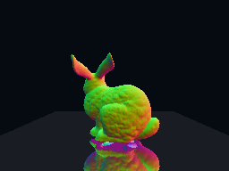

# 单GAS小renderer

CUDA软件二叉BVH、裸TTU、OptiX三后端，共享float32几何、ray、hit和着色；支持箱子网格、三角ASCII PLY、Stanford Bunny，以及水平地面单次镜面。原理、性能和已知失败统一见 [renderer说明](../../docs/RENDERER.md)。



模型署名：Stanford University Computer Graphics Laboratory。图为法线伪彩色；地面反射由CUDA生成二次ray，再交给同一追踪后端。没有复杂材质或物理光照。

## 运行

从ttu-bench根执行，需要空闲SM86 GPU、CUDA12.1/nvcc/g++及上层OptiX8 SDK，Python只用标准库：

```bash
CUDA_VISIBLE_DEVICES=0 timeout 120s python3 bench.py render_demo --images
python3 bench.py prepare_renderer_bunny
CUDA_VISIBLE_DEVICES=0 timeout 180s python3 bench.py render_demo --bunny full --validation geometric --mirror-floor --images
python3 bench.py validate_renderer --gpu 0 --mirror-floor
python3 bench.py validate_renderer_meshes --gpu 0 --check-only
python3 bench.py compare_renderer_builds --gpu 0
```

先选择空闲GPU；output须为空，可用--output指定。默认256×192、block128；--check-only不计时，--backends software optix可只运行公开接口。

默认仅留report.json并自动清理临时编译文件。--images额外输出PNG；--artifacts才保留raw ray/hit/face映射、PNG及编译产物。矩阵默认仅留matrix.json，--artifacts才保留各case和build。通常只需命令及简要结论，检查完应删常规输出。

Bunny准备器校验 [固定hash及来源](assets/stanford-bunny.json)；--archive PATH可用手动下载包，模型本体不入Git。研究/免费再分发及商业许可要求见manifest的Stanford条款。--mesh PATH支持自己的三角ASCII PLY，--mesh-yaw控制朝向。

## 正确性与边界

默认--validation strict；--validation geometric仅为barycentric差异增加几何残差和double CPU复核，保留精确ID/face及原t容差。四级Bunny固定视角只有res3/full通过，res4/res2仍有掠射数值反例，矩阵非零退出是当前预期；不据图像好看而忽略失败。显式--mesh-deduplicate会改变降采样模型的重复面，full无需去重。

--mirror-floor仅做水平地面一次反射，不做ray compaction，非镜面像素仍发dummy miss。计时分别列primary、二次ray生成、secondary、合成及完整管线；三后端的BVH/接口不同，速度比不是纯RT硬件收益。

native默认monolithic O0。--native-build linked可优化caller；直接对monolithic开O1–O3会被marker guard拒绝。公开PTX没有TTU入口，小段SASS patch仍是工具链相关实验接口。

需要raw时：rays.bin是little-endian的8个float（origin.xyz,tmin,dir.xyz,tmax）；hit是IfffII（primitive,t,u,v,front_face,instance_id），miss=ffffffff，未知/溢出=fffffffe。有效GAS命中的instance_id恒ffffffff；未知native事件以hex诊断并失败，不强行解释。
